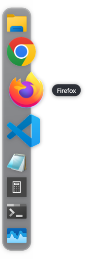
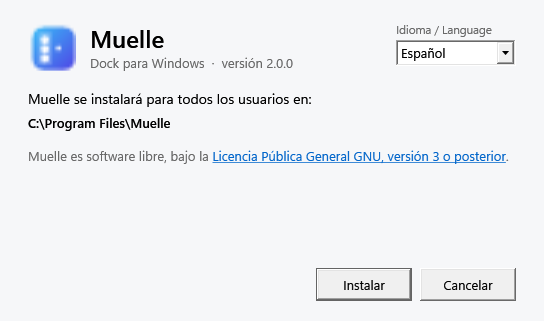
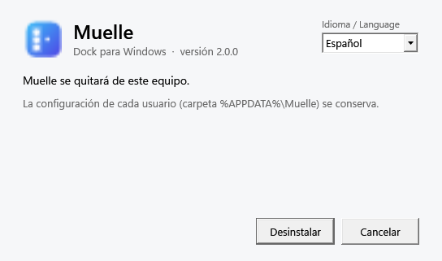
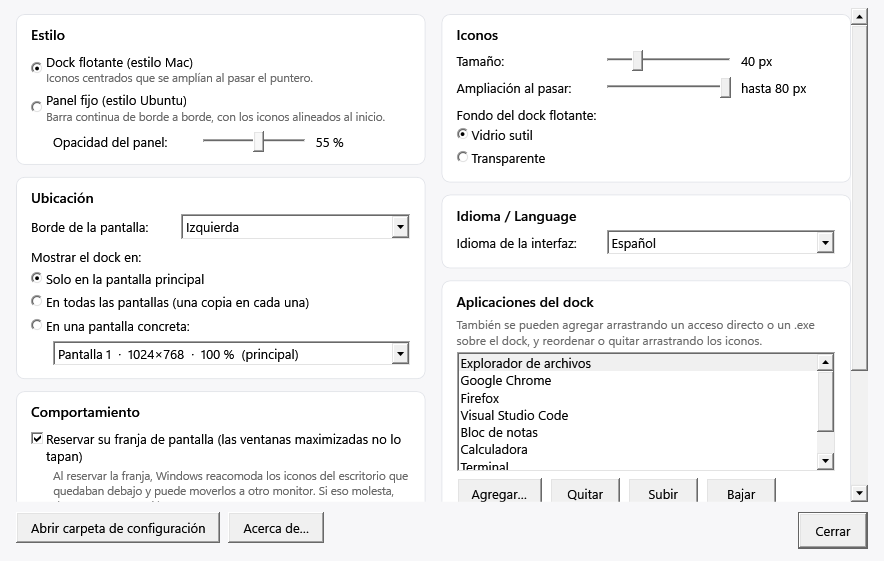

# Muelle

Gabriel Castiglia · 8 de noviembre de 2026 · versión 2.0.0 · licencia GPL-3.0-or-later

[English](README.md) · Español

Manual en PDF: [`docs/Muelle-manual-es.pdf`](docs/Muelle-manual-es.pdf)

Muelle es un dock de aplicaciones para Windows 10 y 11, escrito en C# con .NET 10 y WPF. Puede ser un
dock flotante que amplía los iconos al pasar el puntero, al estilo de macOS, o un panel fijo de borde a
borde, al estilo de Ubuntu. La interfaz está en inglés y en castellano: arranca en el idioma elegido al
instalar (en inglés si corre sin instalación) y se cambia cuando se quiera. El nombre es la palabra
castellana para el lugar donde amarran los barcos, que en inglés se dice «dock».



## Requisitos

- Windows 11, o Windows 10 versión 1803 o posterior, de 64 bits.

No hace falta instalar nada más. Muelle lleva su propio .NET, y la ventana de instalación usa el .NET
Framework que ya trae Windows.

## Instalación

Hay tres formas de tener Muelle, y `scripts\build.ps1` deja las tres en la carpeta `dist`:

| Archivo | Qué es |
|---|---|
| `muelle-setup.exe` | El instalador, en inglés o en castellano. Es la forma habitual. |
| `muelle.msi` | La misma instalación como paquete de Windows Installer, para instalar sin ventanas: `msiexec /i muelle.msi /qn`. |
| `Muelle.exe` | El programa solo; anda sin instalar, desde cualquier carpeta. |

El instalador abre una ventana con un menú de idioma arriba a la derecha, y cada página cambia de idioma
en el acto. Instala Muelle para todos los usuarios en `C:\Program Files\Muelle`, lo que pide permisos de
administrador (Windows los pide al empezar), y lo agrega al menú Inicio. El idioma elegido en esa
ventana es el que usa el dock la primera vez que arranca.



Correr un `muelle-setup.exe` más nuevo actualiza el Muelle instalado y conserva la configuración de cada
usuario. Si Muelle está abierto, el instalador lo cierra antes de reemplazar sus archivos. Una versión
vieja no se puede instalar encima de una más nueva.

Para que Muelle arranque con Windows, marcar Configuración → Comportamiento → «Iniciar Muelle al
encender Windows».

## Desinstalación

En la Configuración de Windows, Aplicaciones → Aplicaciones instaladas, buscar Muelle y elegir
Desinstalar. Se abre la misma ventana del instalador, con su menú de idioma, en el idioma que se eligió
al instalar. Cierra Muelle si está abierto, quita el programa y su acceso del menú Inicio, y borra la
entrada de «Iniciar con Windows» del usuario que desinstala.

La configuración de cada usuario, en `%APPDATA%\Muelle`, se conserva, así una instalación posterior la
encuentra. Para borrarla también, eliminar esa carpeta.

Para desinstalar sin ventanas: `muelle-setup.exe /uninstall /quiet`.



## Uso del dock

- Un clic en un icono abre la aplicación o, si ya está abierta, trae su ventana al frente; con varias
  ventanas, cada clic trae la siguiente. Un clic sobre la única ventana que ya está al frente la
  minimiza. Mayúsculas+clic o el botón del medio abren una ventana nueva.
- El icono rebota mientras la aplicación arranca, y un punto debajo marca las aplicaciones abiertas.
- Las aplicaciones abiertas que no están en el dock aparecen al final y se van al cerrarse. «Mantener en
  el dock» en su menú, o arrastrarlas entre las demás, las deja fijas.
- Las aplicaciones se agregan soltando un acceso directo o un `.exe` sobre el dock, con «Agregar
  aplicación…» en el menú del dock o desde Configuración. También se pueden agregar apps de la Tienda
  (Teams, Terminal…) y objetos del sistema como el Panel de control.
- Los iconos se reordenan arrastrándolos a lo largo del dock y se quitan arrastrándolos afuera.
  «Bloquear iconos» impide las dos cosas, para evitar cambios por accidente.
- Cuando los iconos no entran en una pantalla, se achican solo en esa pantalla.
- Con una aplicación a pantalla completa (un video, un juego) el dock pasa por detrás.

El clic derecho sobre un icono ofrece Mostrar (o Abrir), Abrir otra ventana, Ejecutar como
administrador, Abrir ubicación del archivo, Finalizar tarea (en las aplicaciones con procesos propios) y
Mantener en el dock o Quitar del dock. El clic derecho sobre el dock ofrece Agregar aplicación…, el
cambio entre dock flotante y panel fijo, Bloquear iconos, el menú de idioma, Configuración…, Acerca de
Muelle… y Salir de Muelle.

## Configuración

Clic derecho sobre el dock → Configuración…. Cada cambio se aplica en el momento.



| Grupo | Opciones |
|---|---|
| Estilo | Dock flotante (estilo Mac) o panel fijo (estilo Ubuntu); opacidad del panel. |
| Ubicación | Borde de la pantalla; la pantalla principal, todas las pantallas (una copia en cada una) o una pantalla concreta. |
| Comportamiento | Reservar la franja de pantalla, ocultar automáticamente, mostrar las apps abiertas que no están fijadas, bloquear los iconos, iniciar con Windows. |
| Iconos | Tamaño (de 24 a 96 px), ampliación al pasar el puntero (hasta el doble), fondo del dock flotante. |
| Idioma | Inglés o castellano. |
| Aplicaciones del dock | La lista de aplicaciones fijas, con Agregar, Quitar, Subir y Bajar. |

## Idioma

La interfaz está en inglés y en castellano. El idioma se cambia desde el menú del dock (Idioma /
Language, rotulado en los dos idiomas para encontrarlo desde cualquiera) o en Configuración, y queda
guardado. Los nombres de las aplicaciones que Muelle agrega en su primer arranque (Explorador de
archivos, Bloc de notas, Calculadora…) siguen el idioma de la interfaz.

## Archivos

| Qué | Dónde |
|---|---|
| Programa instalado | `C:\Program Files\Muelle` |
| Configuración | `%APPDATA%\Muelle\config.json` (se puede borrar para empezar de cero) |
| Registro de errores, si algo falla | `%APPDATA%\Muelle\muelle.log`, de menos de 512 KB (la parte anterior queda en `muelle.old.log`) |

## Limitaciones conocidas

- Cuando Muelle reserva su franja de pantalla, Windows reacomoda los iconos del escritorio que quedaban
  debajo y puede pasarlos a otro monitor. Así trata Windows a cualquier barra de aplicaciones. Si
  molesta, desmarcar «Reservar su franja de pantalla»; las ventanas maximizadas pasan entonces por
  debajo del dock.

## Compilar desde el código

Con el [SDK de .NET 10](https://dotnet.microsoft.com/download) instalado:

```
dotnet build src\Muelle\Muelle.csproj -c Release
powershell -ExecutionPolicy Bypass -File scripts\build.ps1
```

El primer comando compila el programa. El segundo arma todo en `dist`: el `Muelle.exe` suelto,
`muelle.msi` y `muelle-setup.exe`; el WiX Toolset 5 se baja solo como paquete NuGet. La versión se fija
en un solo lugar, `src\Muelle\Muelle.csproj`, y los instaladores y la ventana Acerca de la leen de ahí.

`scripts\screenshots.ps1` genera las imágenes de `docs\images`, y `scripts/manual.sh` (en macOS, con
pandoc y Google Chrome) arma los manuales en PDF a partir de `README.md` y de este archivo.

| Carpeta | Contenido |
|---|---|
| `src/Muelle` | El programa. |
| `installer/Msi` | El paquete MSI (WiX). |
| `installer/SetupUI` | La ventana del instalador, en inglés y en castellano (.NET Framework 4.7.2, WPF). |
| `installer/Setup` | El instalador que lleva esa ventana y el MSI (bundle de WiX). |
| `scripts` | Compilación, imágenes, icono y manuales. |
| `docs` | Manuales en PDF, imágenes y la hoja de estilo del manual. |

## Historial de versiones

Ver [`CHANGELOG.md`](CHANGELOG.md) (en inglés).

## Licencia

Copyright (C) 2026 Gabriel Castiglia.

Muelle es software libre: se puede redistribuir y modificar según los términos de la Licencia Pública
General GNU publicada por la Free Software Foundation, versión 3 o, a elección, cualquier versión
posterior. Se distribuye SIN NINGUNA GARANTÍA. El texto completo está en [`LICENSE`](LICENSE).
