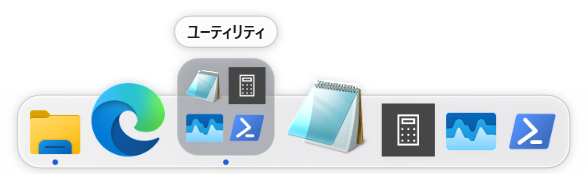
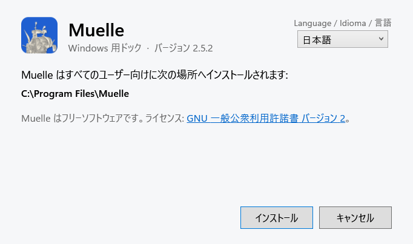
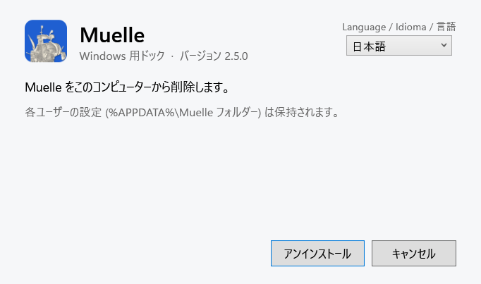
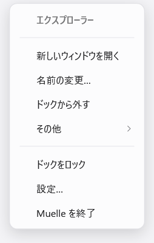
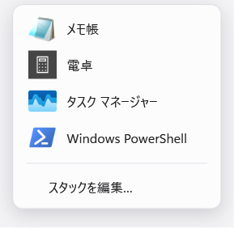
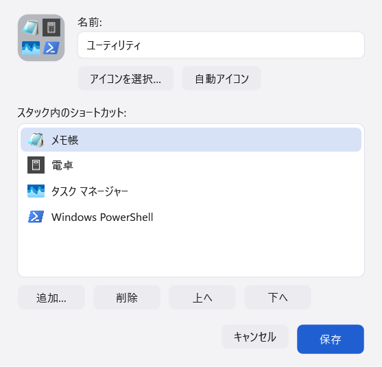
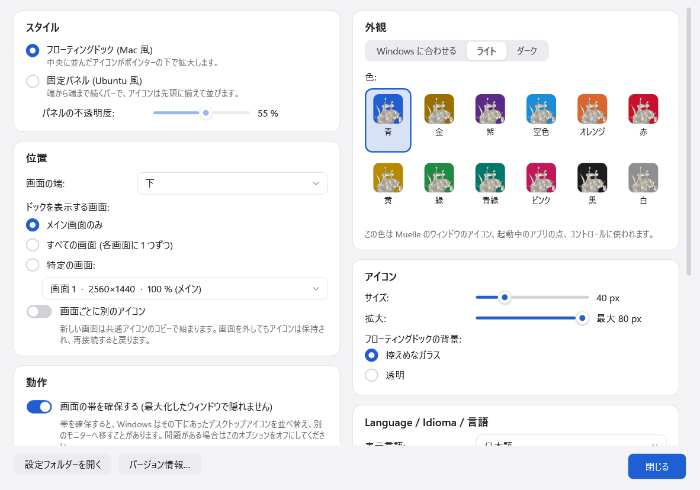
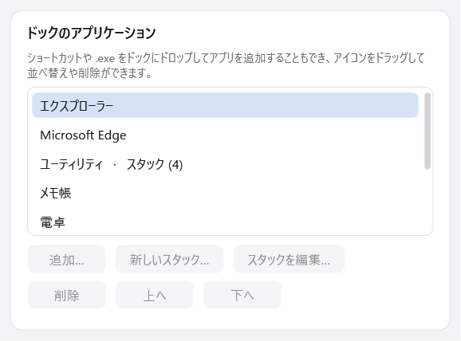
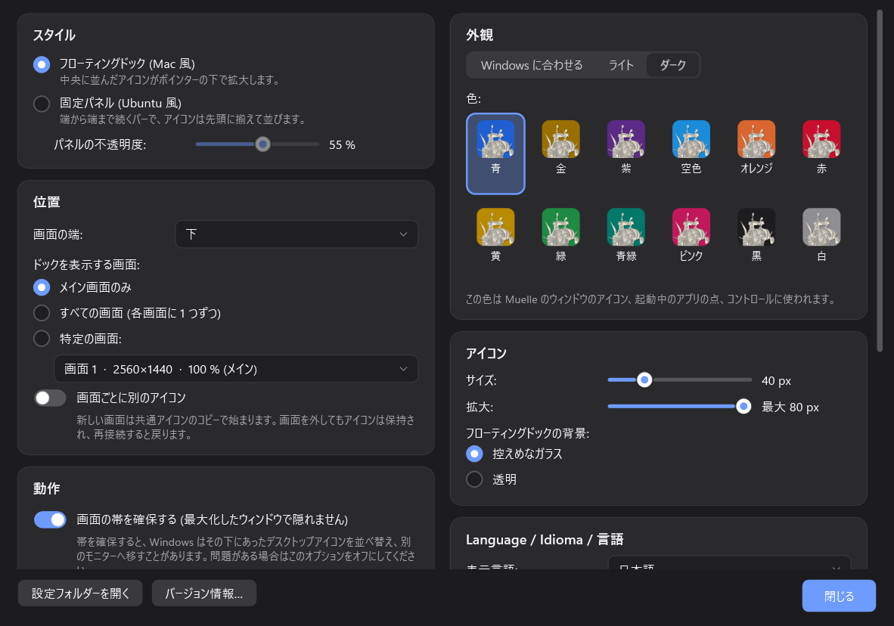
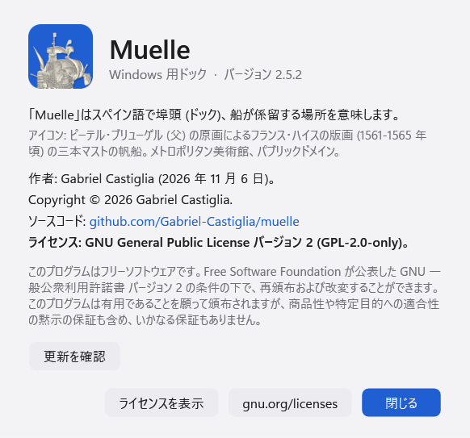

<p align="center"></p>

<h1 align="center">Muelle</h1>
<p align="center"><b>Windows 用ドック。Mac のように浮かせても、Ubuntu のように画面端に固定しても使えます。</b></p>

<p align="center"></p>

Gabriel Castiglia · 2026 年 11 月 28 日 · バージョン 2.6.1 · GPL-2.0-only

[English](README.md) · [Español](README.es.md) · 日本語

PDF マニュアル: [`docs/Muelle-manual-ja.pdf`](docs/Muelle-manual-ja.pdf)

> **Windows 10/11 の x64（64 ビットの Intel または AMD）専用です。** ARM プロセッサ用のビルドはありません。

Muelle は Windows 10 と 11 のためのアプリケーションドックで、C#、.NET 10、WPF で書かれています。macOS 風にポインターの下のアイコンが拡大されるフローティングドックにも、Ubuntu 風に画面の端から端まで届く固定パネルにもできます。画面の言語は英語、スペイン語、日本語で、セットアップで選んだ言語で起動し（インストールせずに実行した場合は英語）、いつでも変更できます。外観はライト、ダーク、または Windows に合わせることができ、12 色から色を選べます。複数のショートカットを 1 つのアイコンにまとめる「スタック」、画面ごとのアイコン、新しいバージョンの自動インストールにも対応しています。「Muelle」はスペイン語で船が係留される「埠頭」を意味します。

## 動作環境

- Windows 11、または Windows 10 バージョン 1803 以降。x64 プロセッサ（64 ビットの Intel または AMD）。

ほかにインストールするものはありません。Muelle は自分の .NET ランタイムを内蔵しており、セットアップ画面は Windows に最初から入っている .NET Framework で動きます。

## インストール

[最新リリース](https://github.com/Gabriel-Castiglia/muelle/releases/latest)からファイルをダウンロードします。入手方法は 3 つあり、どれも `scripts\build.ps1` が `dist` フォルダーに作ります。

| ファイル | 内容 |
|---|---|
| `muelle-setup.exe` | セットアッププログラム（英語、スペイン語、日本語）。通常はこれでインストールします。 |
| `muelle.msi` | 同じインストールの Windows インストーラー パッケージ。サイレントインストール用: `msiexec /i muelle.msi /qn`。 |
| `Muelle.exe` | プログラム単体。インストールせずに任意のフォルダーから実行できます。 |

各リリースには、このマニュアルの PDF 版（英語、スペイン語、日本語: `Muelle-manual-en.pdf`、`Muelle-manual-es.pdf`、`Muelle-manual-ja.pdf`）も含まれています。各リリースの `SHA256SUMS.txt` で、ダウンロードしたファイルを先に確認できます（PowerShell で `Get-FileHash muelle-setup.exe`）。

セットアップを起動すると、右上に言語メニュー（英語、スペイン語、日本語の順）のある画面が開き、選ぶとすべてのページの言語がすぐに切り替わります。Muelle はすべてのユーザー向けに `C:\Program Files\Muelle` にインストールされるため管理者権限が必要です（インストール開始時に Windows が確認します）。スタートメニューにも追加されます。セットアップで選んだ言語が、ドックを初めて起動したときの言語になります。



新しい `muelle-setup.exe` を実行すると、インストール済みの Muelle が更新され、各ユーザーの設定はそのまま残ります。Muelle が実行中なら、セットアップがファイルを置き換える前に終了させ、完了後に再び起動します。新しいバージョンの上に古いバージョンをインストールすることはできません。インストール済みの Muelle は自分で更新することもできます。[新しいバージョン](#新しいバージョン)を参照してください。

画面を出さずにインストールするには: `muelle-setup.exe /quiet`（管理者権限の確認は表示されます）。

Windows と一緒に Muelle を起動するには、設定 → 動作 →「Windows の起動時に Muelle を開始する」をオンにします。Muelle を起動するタスク スケジューラのタスク（`\Muelle (inicio de sesion)` または `\Muelle`）を自分で作ってある場合は、このチェックボックスはそのタスクに従います。オンにするとタスクが有効に、オフにすると無効になり、二重に起動しないようレジストリの「Run」キーは使われません。この変更はバックグラウンドで行われるので、Windows が反映している間も設定画面が固まることはありません。

## アンインストール

Windows の設定 → アプリ → インストールされているアプリで Muelle を探し、「アンインストール」を選びます。言語メニュー付きの同じセットアップ画面が、インストール時に選んだ言語で開きます。Muelle が実行中なら終了させ、プログラムとスタートメニューのショートカットを削除し、アンインストールしたユーザーの「Windows と一緒に起動」の登録も削除します。

各ユーザーの設定（`%APPDATA%\Muelle`）は残るので、あとで再インストールしたときに引き継がれます。設定も消すには、そのフォルダーを削除してください。

画面を出さずにアンインストールするには: `muelle-setup.exe /uninstall /quiet`。



## ドックの使い方

- アイコンをクリックするとアプリが開きます。すでに開いていれば、そのウィンドウが前面に出ます。ウィンドウが複数あるときは、クリックするたびに次のウィンドウが出ます。すでに前面にある唯一のウィンドウをクリックすると最小化されます。Shift + クリックまたは中クリックで新しいウィンドウを開きます。
- アプリの起動中はアイコンが弾み、開いているアプリにはアイコンの下に点が付きます。
- アイコンはアプリに追従します。アプリが更新されたとき（ストアアプリも）、アプリが自分のアイコンの色を変えたとき（Vigía がテーマの色で変えるように）、ショートカットや選んだアイコンファイルが変わったときは、再起動しなくても 15 秒以内に新しいアイコンになります。プログラムの場合、プログラム自身のショートカットが指すアイコンファイルがプログラムのフォルダーにあれば、ドックはそれを使います。1 つのショートカットに別の場所から手で選んだアイコンはそのまま残ります。
- ドックにない開いているアプリは末尾に表示され、閉じると消えます。メニューの「ドックに固定」、またはほかのアイコンの間へのドラッグで残せます。
- アプリは、ショートカットや `.exe` をドックにドロップするか、ドックのメニューの「アプリケーションを追加…」、または設定から追加します。ストアアプリ（Teams、ターミナルなど）やコントロールパネルのようなシェルオブジェクトも追加できます。
- アイコンはドックに沿ってドラッグすると並べ替えられ、ドックの外へドラッグすると削除されます。「ドックをロック」にするとどちらもできなくなり、メニューからの固定、外す操作、名前の変更もできなくなるので、うっかり変えてしまうのを防げます。設定 → ドックのアプリケーションでも、アイコンを変更するボタン（追加…、新しいスタック…、スタックを編集…、削除、上へ、下へ）が淡色表示になり、その理由をツールチップで説明します。ロックをオフにすると、ドックのメニューからでも設定からでも、設定画面を開いたまますぐに使えるようになります。
- スタックは複数のショートカットを入れた 1 つのアイコンで、クリックすると横に広がります。[スタック](#スタック)を参照してください。
- ドックが空のときは「+」の枠（「ここにアプリをドラッグしてください」）が表示されます。そこにアプリをドロップするか、クリックして選びます。
- アイコンが画面に収まらないときは、その画面のアイコンだけが小さくなります。
- 全画面のアプリ（動画、ゲーム）が前面にある間、ドックは完全に隠れ、ポインターを画面の端に動かしても出てきません。アプリが全画面をやめると戻ります。

| 操作 | 結果 |
|---|---|
| クリック | アプリを開く、ウィンドウを前面に出す、または次のウィンドウを出します。前面にある唯一のウィンドウは最小化します。 |
| Shift + クリック、または中クリック | アプリの新しいウィンドウを開きます。 |
| 右クリック | アイコンのメニュー。ドックの何もないところではドックのメニュー。 |
| ドックに沿ってドラッグ / ドックの外へドラッグ | アイコンを並べ替え / 削除します（「ドックをロック」中は不可）。 |
| ショートカットや `.exe` をドロップ | その位置に追加します。 |

アイコンを右クリックすると、アプリ名を先頭にしたメニューが開きます。

- 固定したアプリ: 新しいウィンドウを開く（アプリが閉じているときは「開く」）、名前の変更…、ドックから外す、その他（管理者として実行、ファイルの場所を開く、ドックにスタックがあるときは「スタックへ移動」）。
- 固定していない起動中のアプリ: 新しいウィンドウを開く、ドックに固定、その他（管理者として実行、ファイルの場所を開く）。
- スタック: スタックを開く、スタックを編集…、ドックから外す。

続いて、ドックをロック（オンの間はチェックが付きます）、設定…、Muelle を終了。「タスクの終了」はアプリの実行中だけ、最後に離して表示されます。確認なしですぐにアプリを終了させるので、保存していない内容は失われます。ドックの何もないところを右クリックすると、アプリケーションを追加…、新しいスタック…、ドックをロック、設定…、Muelle を終了が出ます。「ドックをロック」がオンのときは、アイコンを変更する項目は淡色表示になり、ツールチップで「ドックはロックされています。アイコンを変更するには「ドックをロック」をオフにしてください。」と理由を説明します。それ以外（スタイル、言語、外観、更新、バージョン情報）はすべて設定にあります。



「名前の変更…」では、ポインターを合わせたときに表示される名前を変えられます。空欄にすると、プログラム本来の名前に戻ります。

## スタック

スタックは Mac のドックのスタックのように、複数のショートカットを 1 つのアイコンにまとめます。クリックするとショートカットがそれぞれのアイコン付きで横に広がり、1 つをクリックするとそれが開きます（すでに開いていればそのウィンドウが前面に出ます）。一覧の最後の「スタックを編集…」でスタックエディターが開きます。ショートカットのないスタックには「スタックは空です」と表示されます。



- ドックのメニュー、または設定 → ドックのアプリケーションの「新しいスタック…」で作成します。
- エディターでは、スタックの名前、アイコン（専用のもの:「アイコンを選択…」で `.ico`、プログラム、画像のどれか。または「自動アイコン」: 最初の 4 つのショートカットを格子状に並べたもの）、ショートカット（追加…、削除、上へ、下へ）を設定します。「保存」するまでドックは変わりません。編集中にスタックがドックからなくなった場合（削除された、または「画面ごとに別のアイコン」を切り替えた）、「保存」はそう伝えて何も変えません。
- エディターは一度に 1 つだけ開きます。編集中のスタックでもう一度「スタックを編集…」を選ぶと、そのエディターが前面に出ます。開いているエディターに保存していない変更があるときに別のスタックを編集しようとすると、変更を破棄するかどうかを先に確認します。確認なしに変更が失われることはありません。



- アイコンのメニューの「スタックへ移動」で、そのアイコンをスタックの末尾に入れます。
- スタックはほかのアイコンと同じように移動や削除ができます。スタックに入っているアプリは、開いていてもドックの末尾にもう一度表示されることはありません。

## 画面ごとのアイコン

すべての画面にドックを出すと、既定ではどのドックにも同じアイコンが並びます。設定 → 位置 →「画面ごとに別のアイコン」にすると、画面ごとに別の一覧になります。初めて見る画面は共通のアイコンのコピーから始まり、それ以降はその画面のドック、または設定 → ドックのアプリケーション（画面を選ぶ「アイコンの対象:」一覧が加わります）で、追加、削除、並べ替えができます。

Muelle は画面を、Windows が物理モニターとその接続端子に付ける名前で見分けるので、再起動しても画面の順番が変わってもアイコンは保たれます。Windows がその名前を出さない場合は、表示名と解像度で見分けます。画面を外してもそのアイコンは設定に残り、もう一度つなぐと戻ります。オプションをオフにすると共通のアイコンに戻り、画面ごとのアイコンは次回のために保存されます。

## 設定

ドックを右クリック → 設定…。変更はすぐに反映されます。`Muelle.exe --settings` で起動すると、設定画面が開いた状態で Muelle が始まります（ショートカット用に便利です）。



| グループ | オプション |
|---|---|
| スタイル | フローティングドック（Mac 風。中央に並んだアイコンがポインターの下で拡大）または固定パネル（Ubuntu 風。端から端まで続くバーで、アイコンは先頭に揃う）。パネルの不透明度（0〜100 %、固定パネルのみ）。 |
| 位置 | 画面の端（下、上、左、右）。ドックを表示する画面: メイン画面のみ、すべての画面（各画面に 1 つずつ）、特定の画面。画面ごとに別のアイコン。 |
| 動作 | 画面の帯を確保する（最大化したウィンドウで隠れません。自動的に隠す間は無効）、自動的に隠す（ポインターが端に来ると表示）、固定していない起動中のアプリも表示する、ドックをロック、Windows の起動時に Muelle を開始する、1 日 1 回新しいバージョンを確認する。 |
| 外観 | Windows に合わせる、ライト、ダーク。12 色から 1 色（キーボードでも選べます。Tab で色のグループに移り、矢印キーで色を移動し、Space で選びます）。 |
| アイコン | サイズ（24〜96 px）。ポインターの下での拡大（なし〜最大 2 倍）。フローティングドックの背景（控えめなガラスまたは透明）。拡大と背景はフローティングドックのみ。 |
| Language / Idioma / 言語 | 表示言語: English、Español、日本語。 |
| ドックのアプリケーション | 固定したアプリとスタックの一覧。追加…、新しいスタック…、スタックを編集…（またはダブルクリック）、削除、上へ、下へ。画面ごとのアイコンのときは、「アイコンの対象:」で一覧を表示する画面を選びます。「ドックをロック」がオンのときは、すべてのボタンが淡色表示になり、ダブルクリックしてもスタックエディターは開きません。 |

ウィンドウ下部の「設定フォルダーを開く」はエクスプローラーで `config.json` を表示し、「バージョン情報…」は「Muelle について」を開き、「閉じる」（または Esc キー）でウィンドウを閉じます。選んだスタイルに関係しないオプションは淡色表示になります。



## 外観

Muelle はライト、ダーク、または Windows のアプリの設定（設定 → 個人用設定 → 色）に合わせることができ、Windows の設定が変わるとすぐに切り替わります。ドックは明るいすりガラスか暗いガラスになり、設定、バージョン情報、更新の各ウィンドウもタイトルバーを含めてそれに従います。外観は設定 → 外観で選びます。



色は青（既定）、金、紫、空色、オレンジ、赤、黄、緑、青緑、ピンク、黒、白の 12 色です。選んだ色は、開いているアプリの下の点、スイッチ、スライダー、選択した項目、そして Muelle のウィンドウのアイコン（その色のタイルの上を船が進みます）に使われます。スタートメニューのアイコンは青のままです。Muelle はすべてのユーザー向けにインストールされ、そのショートカットは全員のものだからです。

以前のバージョンの設定ファイルはそれまでのダークのドックのままで、新しくインストールした場合は Windows に合わせます。

## キーボードとスクリーンリーダー

設定、スタックエディター、バージョン情報、更新の各ウィンドウはキーボードだけで操作できます。Tab と Shift + Tab でコントロールを移動し、キーボードのフォーカスがあるコントロールには、アクセントカラーの枠または文字色のリングが表示されます。設定 → 外観では、Tab で 12 色を 1 つのグループとして選択でき、矢印キーで色を移動し、Space で選びます。フォーカスがある色には専用の枠が表示されます。

ドックはキーボードのフォーカスを取らないので、入力は常に前面のアプリに届きます。ナレーターや NVDA などのスクリーンリーダーからは、UI オートメーションを通じて、アイコンごとに 1 つのボタンを持つ「Muelle」という名前のツールバーとして見えます。各ボタンにはアプリまたはスタックの名前が付き、アプリが起動中かどうか、スタックにショートカットがいくつあるかを伝えます。既定の操作はクリックと同じです（アプリを開く、そのウィンドウを前面に出す、またはスタックを開く）。

## 新しいバージョン

Muelle は 1 日に 1 回、GitHub に最新リリースを問い合わせます。バージョン情報（設定 →「バージョン情報…」）の「更新を確認」で、いつでも確認できます。新しいバージョンがあると、小さなウィンドウが「今すぐ更新」「新機能を見る」（リリースページ）「後で」のどれにするかを尋ねます。



「今すぐ更新」を選ぶと、あとはすべて自動で進みます。

1. そのリリースの `SHA256SUMS.txt` には作者の署名（`release.sig`。Muelle に組み込まれた 2 つの公開鍵で確認します）が付いていなければなりません。有効な署名のないリリースは拒否され、そのページから手動でダウンロードするしかありません。続いてセットアップ `muelle-setup.exe` が `%TEMP%\MuelleUpdate` にダウンロードされ、その `SHA256SUMS.txt` と照合されます。一致しないファイルは削除され、実行されません。照合からセットアップが起動するまで、Muelle はファイルを読み取り専用で開いたままにするので、その間に変更、置き換え、削除されることはありません。
2. Muelle は自分の起動方法を記録して終了します。
3. セットアップが、インストール時に選んだ言語で、画面を出さずにインストールします。ほかのインストールと同じく、Windows が管理者権限を確認します。Muelle の終了を待ち、インストールフォルダーから実行中のほかのコピーも終了させます。
4. Muelle が同じ引数でもう一度開き、更新されたことを伝えます。

何かが失敗した場合は何もインストールされません。Muelle はそのまま動き続けるか再び開き、何が起きたかを伝えます（たとえば管理者権限が拒否されたとき）。インストールせずに実行している `Muelle.exe` は自分を置き換えられないので、その場合はリリースページだけを案内します。

問い合わせで送るのは、プログラム名とバージョンだけです。毎日の確認は設定 → 動作でオフにできます。

## 言語

画面は英語、スペイン語、日本語です。言語は設定で変更でき（どの言語からでも見つけられるよう「Language / Idioma / 言語」と 3 か国語で表示）、変更は記憶されます。セットアップ画面は、Muelle が別の言語ですでにインストールされていない限り英語で始まります。Muelle が初回起動時に追加するアプリの名前（エクスプローラー、メモ帳、電卓など）は画面の言語に従います。

## ファイル

| 内容 | 場所 |
|---|---|
| インストールされたプログラム | `C:\Program Files\Muelle`。`LICENSE.txt`、`README.txt`、`README.es.txt`、`README.ja.txt` も一緒です |
| 設定 | `%APPDATA%\Muelle\config.json`（削除すると最初からやり直せます）。最後に保存する前の版は `config.previous.json` |
| 読めなかった設定 | このバージョンが読めないアイコンや設定はそれだけが外され、一覧全体が消えることはありません。外されたものは `config.dropped-<日付>.json` に、元のファイル全体は `config.partial-<日付>.json` に保存されます |
| エラーログ（何か失敗したとき） | `%APPDATA%\Muelle\muelle.log`。512 KB 以下に保たれます（前の部分は `muelle.old.log`） |
| インストール中の更新 | `%TEMP%\MuelleUpdate`（セットアップと Muelle の起動方法）。更新のインストールから 1 分後に削除されます |

## トラブルシューティング

| 症状 | 対処 |
|---|---|
| ドックが見えない | 全画面のアプリが前面にあると隠れます。「自動的に隠す」がオンなら、ポインターを画面の端に動かすと出てきます。設定 → 位置 →「ドックを表示する画面:」も確認してください。実行中に Muelle をもう一度起動しても何も起きません（ドックは 1 つだけです）。 |
| アプリが開かない | Muelle が Windows の理由を添えて「開けませんでした」と伝えます。プログラムを移動またはアンインストールした場合は、アイコンを削除して追加し直してください。 |
| アイコンが古いまま | ドックは 15 秒ごとに新しいアイコンを確認します。変わらない場合は、アイコンを削除して追加し直してください。 |
| 設定がおかしい | Muelle を終了し、`%APPDATA%\Muelle\config.json` を削除すると最初からやり直せます。`config.previous.json` を `config.json` に名前を変えると、1 つ前の保存に戻ります（設定の「設定フォルダーを開く」でフォルダーが開きます）。 |
| 更新に失敗した | Muelle がそれを伝え、今のバージョンのまま動きます。セットアップのログは `%TEMP%` にあります。セットアップはいつでも[リリースページ](https://github.com/Gabriel-Castiglia/muelle/releases/latest)からダウンロードして手動で実行できます。 |
| ほかの問題 | 詳細は `%APPDATA%\Muelle\muelle.log` にあります。 |

## 既知の制限

- Muelle が画面の帯を確保すると、Windows はその下にあったデスクトップアイコンを並べ直し、別のモニターに移すことがあります。これはアプリケーションバー全般に対する Windows の動作です。困る場合は「画面の帯を確保する」をオフにしてください。その場合、最大化したウィンドウはドックの下に入ります。

## ソースからのビルド

[.NET 10 SDK](https://dotnet.microsoft.com/download) をインストールした状態で:

```
dotnet build src\Muelle\Muelle.csproj -c Release
powershell -ExecutionPolicy Bypass -File scripts\build.ps1
```

1 つ目のコマンドはプログラムをビルドします。2 つ目は `dist` にすべてを作ります。単体の `Muelle.exe`、`muelle.msi`、`muelle-setup.exe` を作り、それぞれの SHA-256 を表示します（ハッシュのファイルは書き出しません。リリースのハッシュと署名は別に公開します）。WiX Toolset 5 は NuGet パッケージとして自動で復元されます。リリースには `muelle-setup.exe`、`SHA256SUMS.txt`、`release.sig` がこの名前で必要です。更新機能がこれらを探すためです。

`Muelle.exe --self-test <ログ>` は、設定ファイル、スタック、画面ごとのアイコン、設定でのロック、ドックと色がスクリーンリーダーからどう見えるか、アプリに追従するアイコン、全画面アプリの検出、更新機能（バージョンの比較、ハッシュ、署名、起動するまで開いたままにするセットアップ、セットアップのコマンドライン）を確認し、確認ごとに 1 行をログに書きます。終了コードは失敗の数です。`%TEMP%` の使い捨ての設定フォルダーで動いて最後に削除し、ウィンドウは表示せず、実行中の Muelle には触れません。`--online` を付けると、最新リリースのセットアップもダウンロードして（実行はせずに）`SHA256SUMS.txt` と署名で確認します。バージョンは `src\Muelle\Muelle.csproj` の 1 か所だけで設定され、インストーラーとバージョン情報画面はそこから読みます。

`scripts\screenshots.ps1` はサンプルのアプリで `docs\images` の画像を作ります（デスクトップのセッションから実行します。SSH 経由ではドックの画像が空になります）。`scripts/manual.sh`（pandoc と Google Chrome が必要。macOS または Windows の Git Bash で動きます）は、README から PDF マニュアルと `README.txt`、`README.es.txt`、`README.ja.txt` を作ります。`scripts/make_icon.py` は `assets/` の版画からアイコンを 12 色で描きます（Python 3 と numpy、opencv-python、Pillow）。

| フォルダー | 内容 |
|---|---|
| `src/Muelle` | プログラム。 |
| `installer/Msi` | MSI パッケージ（WiX）。 |
| `installer/SetupUI` | セットアップ画面。英語、スペイン語、日本語（.NET Framework 4.7.2、WPF）。 |
| `installer/Setup` | セットアップ画面と MSI を入れたセットアッププログラム（WiX バンドル）。 |
| `scripts` | ビルド、画像、アイコン、マニュアル。 |
| `assets` | アイコンの元になった版画。 |
| `docs` | PDF マニュアル、画像、マニュアルのスタイルシート。 |

## 更新履歴

[`CHANGELOG.ja.md`](CHANGELOG.ja.md) を参照してください。

## ライセンス

Copyright (C) 2026 Gabriel Castiglia.

Muelle はフリーソフトウェアです。Free Software Foundation が公表した GNU 一般公衆利用許諾書バージョン 2 のみ（GPL-2.0-only）の条件の下で、再頒布や改変ができます。いかなる保証もありません。全文は [`LICENSE`](LICENSE) を参照してください。

アイコンは、ピーテル・ブリューゲル（父）の原画によるフランス・ハイスの版画（『帆船』、1561〜1565 年頃）にある武装した 3 本マストの船です。メトロポリタン美術館所蔵、パブリックドメイン（CC0）。
