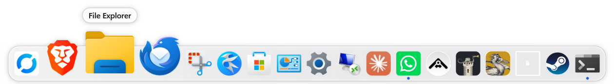
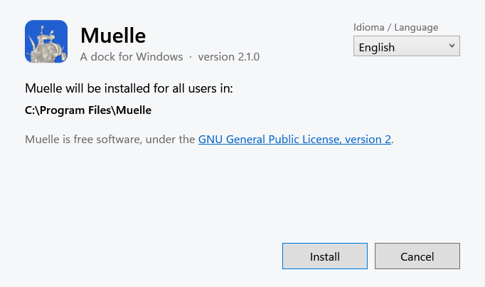
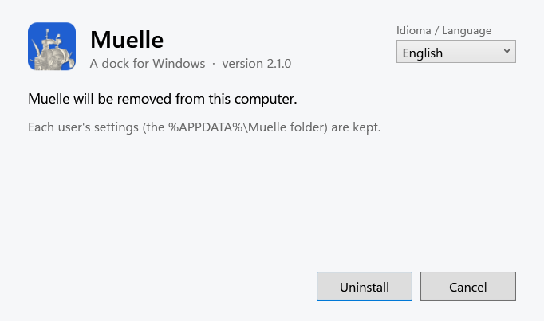
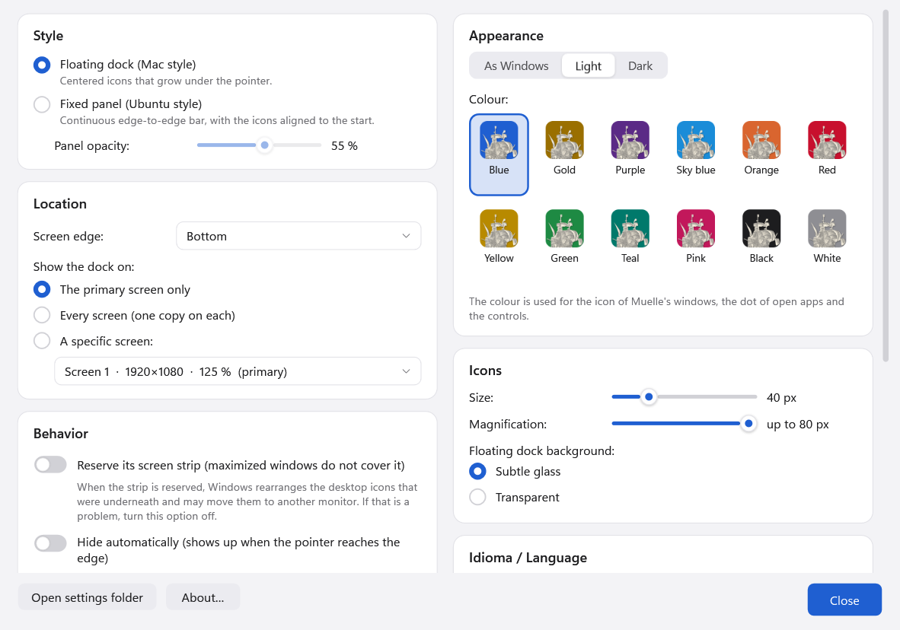
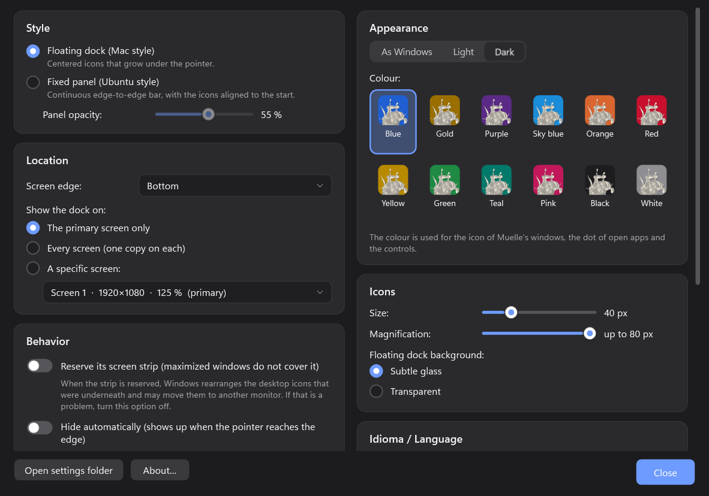

<p align="center"></p>

<h1 align="center">Muelle</h1>
<p align="center"><b>A dock for Windows, floating like the Mac's or fixed like Ubuntu's.</b></p>

<p align="center"></p>

Gabriel Castiglia · November 11, 2026 · version 2.1.0 · GPL-2.0-only

English · [Español](README.es.md)

PDF manual: [`docs/Muelle-manual-en.pdf`](docs/Muelle-manual-en.pdf)

> **Windows 10/11 on x64 (64-bit Intel or AMD) only.** There is no build for ARM processors.

Muelle is an application dock for Windows 10 and 11, written in C# with .NET 10 and WPF. It can be a
floating dock with magnification under the pointer, in the style of macOS, or a fixed panel from edge
to edge, in the style of Ubuntu. Its interface is available in English and Spanish; it starts in the
language chosen during setup (English when it runs without installation) and can be changed at any
time. It can be light, dark or follow Windows, in one of twelve colours. "Muelle" is the Spanish word for a
dock, the place where ships moor.

## Requirements

- Windows 11, or Windows 10 version 1803 or later, on an x64 processor (64-bit Intel or AMD).

Nothing else has to be installed. Muelle carries its own .NET runtime, and the setup window runs on
the .NET Framework that Windows already includes.

## Installation

Download the files from the [latest release](https://github.com/Gabriel-Castiglia/muelle/releases/latest). There
are three ways to get Muelle, all built by `scripts\build.ps1` into the `dist` folder:

| File | What it is |
|---|---|
| `muelle-setup.exe` | Setup program, in English or Spanish. The usual way to install. |
| `muelle.msi` | The same installation as a Windows Installer package, for silent installs: `msiexec /i muelle.msi /qn`. |
| `Muelle.exe` | The program on its own; it runs without installation from any folder. |

The `SHA256SUMS.txt` file of each release lets you check a download first, in PowerShell:
`Get-FileHash muelle-setup.exe`.

The setup program opens a window with a language menu in its top right corner, and every page
changes language at once. It installs Muelle for all users in `C:\Program Files\Muelle`, which takes
administrator rights (Windows asks for them when installation starts), and adds Muelle to the Start
menu. The language chosen in the setup window is the one the dock uses when it starts for the first
time.



Running a newer `muelle-setup.exe` updates an installed Muelle and keeps each user's settings. If
Muelle is running, setup closes it before replacing its files. An older version cannot be installed
over a newer one.

To start Muelle with Windows, turn on Settings → Behavior → "Start Muelle when Windows starts".

## Uninstallation

Open Windows Settings → Apps → Installed apps, find Muelle and choose Uninstall. The same setup
window opens, with its language menu, in the language chosen when Muelle was installed. It closes
Muelle if it is running, removes the program and the Start menu shortcut, and deletes the "Start with
Windows" entry of the user who uninstalls.

Each user's settings, in `%APPDATA%\Muelle`, are kept, so a later installation finds them. To remove
them as well, delete that folder.

For an uninstall without windows: `muelle-setup.exe /uninstall /quiet`.



## Using the dock

- A click on an icon opens the application or, if it is already open, brings its window to the
  front; with several windows, each click brings the next one. A click on the only window that is
  already in front minimizes it. Shift+click or a middle click opens a new window.
- The icon bounces while an application starts, and a dot under an icon marks an open application.
- Open applications that are not in the dock appear at its end and leave when they close. "Keep in
  dock" in their menu, or dragging them among the others, keeps them.
- Applications are added by dropping a shortcut or an `.exe` on the dock, with "Add application…" in
  the dock menu, or from Settings. Store apps (Teams, Terminal…) and shell objects such as Control
  Panel can be added too.
- Icons are reordered by dragging them along the dock and removed by dragging them out of it. "Lock
  icons" prevents both, to avoid accidental changes.
- When the icons do not fit on a screen, they shrink on that screen only.
- With a full-screen application (a video, a game) the dock moves behind it.

Right-clicking an icon offers Show (or Open), Open another window, Run as administrator, Open file
location, End task (for applications with their own processes), and Keep in dock or Remove from dock.
Right-clicking the dock offers Add application…, the switch between floating dock and fixed panel,
Lock icons, the language and appearance menus, Settings…, About Muelle… and Quit Muelle.

## Settings

Right-click the dock → Settings…. Every change applies at once.



| Group | Options |
|---|---|
| Style | Floating dock (Mac style) or fixed panel (Ubuntu style); panel opacity. |
| Location | Screen edge; the primary screen, every screen (one copy on each) or a specific screen. |
| Behavior | Reserve the screen strip, hide automatically, show open apps that are not pinned, lock the icons, start with Windows, tell me when there is a new version. |
| Appearance | As Windows, light or dark; one of twelve colours. |
| Icons | Size (24 to 96 px), magnification under the pointer (up to twice the size), background of the floating dock. |
| Language | English or Spanish. |
| Dock applications | The list of pinned applications, with Add, Remove, Move up and Move down. |

## Appearance

Muelle can be light, dark or follow the setting of Windows for apps (Settings → Personalization →
Colors), and changes at once when Windows changes. The dock turns into frosted light glass or dark glass,
and the settings, About and update windows follow, title bar included. The appearance is chosen in
Settings → Appearance or from the dock menu.



There are twelve colours. The one chosen colours the dot under open apps, the switches, sliders and
selected items, and the icon of Muelle's windows: the ship sails on a tile of that colour. The icon of
the Start menu stays blue, because Muelle is installed for all users and that shortcut belongs to all of
them.

A settings file from an earlier version keeps the dark dock it had; a new installation follows Windows.

## New versions

Once a day, Muelle asks GitHub for the number of the latest version. If it is newer, a small window says so
and offers to open the download page; Muelle never downloads or installs anything by itself. The request
carries nothing but the program name and its version. Turn it off in Settings → Behavior → "Tell me when
there is a new version"; About Muelle… → "Check for a new version" asks at any time.

## Language

The interface is in English and Spanish. The language can be changed from the dock menu (Idioma /
Language, labeled in both languages so it can be found from either one) or in Settings, and it is
remembered. The names of the applications that Muelle adds on its first start (File Explorer, Notepad,
Calculator…) follow the interface language.

## Files

| What | Where |
|---|---|
| Installed program | `C:\Program Files\Muelle`, with `LICENSE.txt`, `README.txt` and `README.es.txt` |
| Settings | `%APPDATA%\Muelle\config.json` (it can be deleted to start over) |
| Error log, if anything fails | `%APPDATA%\Muelle\muelle.log`, kept under 512 KB (the previous part in `muelle.old.log`) |

## Known limitations

- When Muelle reserves its strip of the screen, Windows rearranges the desktop icons that were
  underneath and may move them to another monitor. This is how Windows treats any application bar. If
  it is a problem, turn off "Reserve its screen strip"; maximized windows will then go under the dock.

## Building from source

With the [.NET 10 SDK](https://dotnet.microsoft.com/download) installed:

```
dotnet build src\Muelle\Muelle.csproj -c Release
powershell -ExecutionPolicy Bypass -File scripts\build.ps1
```

The first command builds the program. The second builds everything in `dist`: the stand-alone
`Muelle.exe`, `muelle.msi` and `muelle-setup.exe`; the WiX Toolset 5 is restored automatically as a
NuGet package. The version is set in one place, `src\Muelle\Muelle.csproj`, and the installers and the
About window read it from there.

`scripts\screenshots.ps1` renders the images in `docs\images` (from a desktop session: over SSH the dock
image comes out empty), and `scripts/manual.sh` (on macOS, with pandoc and Google Chrome) builds the PDF
manuals and `README.txt` and `README.es.txt` from this file and `README.es.md`. `scripts/make_icon.py`
draws the icon in its twelve colours from the engraving in `assets/` (Python 3 with numpy, opencv-python
and Pillow).

| Folder | Contents |
|---|---|
| `src/Muelle` | The program. |
| `installer/Msi` | The MSI package (WiX). |
| `installer/SetupUI` | The setup window, in English and Spanish (.NET Framework 4.7.2, WPF). |
| `installer/Setup` | The setup program that carries the setup window and the MSI (WiX bundle). |
| `scripts` | Build, images, icon and manuals. |
| `assets` | The engraving the icon comes from. |
| `docs` | PDF manuals, images and the manual stylesheet. |

## Version history

See [`CHANGELOG.md`](CHANGELOG.md).

## License

Copyright (C) 2026 Gabriel Castiglia.

Muelle is free software: you can redistribute it and/or modify it under the terms of the GNU General
Public License, version 2 only (GPL-2.0-only), as published by the Free Software Foundation. It is
distributed WITHOUT ANY WARRANTY. See [`LICENSE`](LICENSE) for the full text.

The icon is the armed three-master of Frans Huys's engraving after Pieter Bruegel the Elder (The Sailing
Vessels, c. 1561-1565), The Metropolitan Museum of Art, public domain (CC0).
