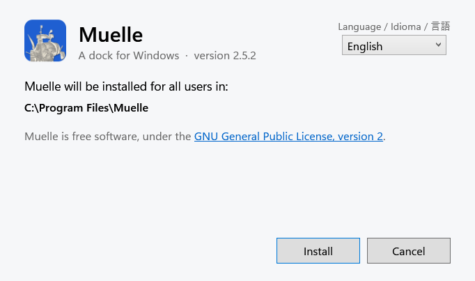
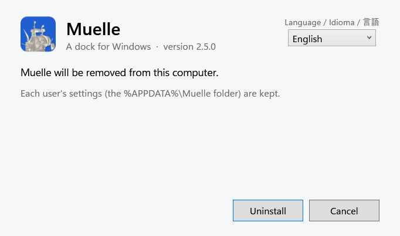
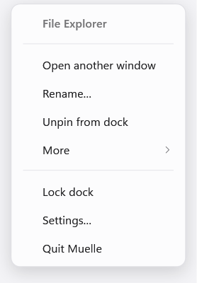
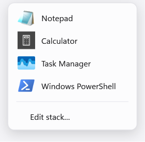
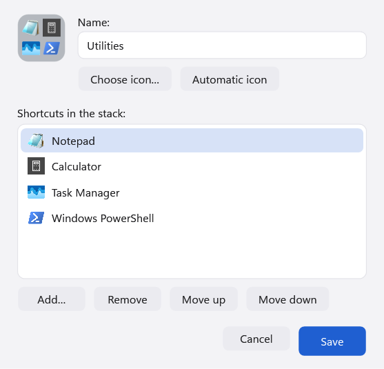
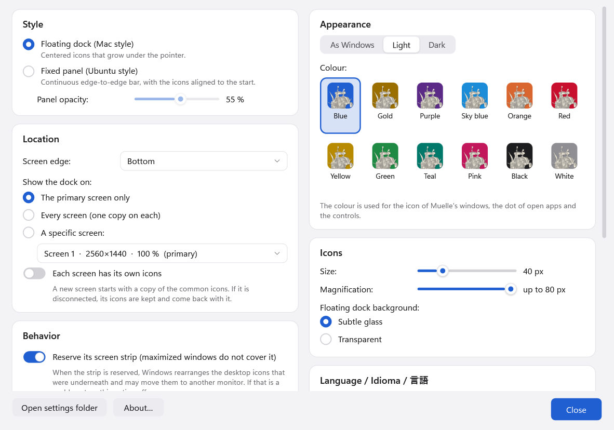
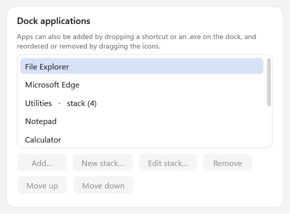
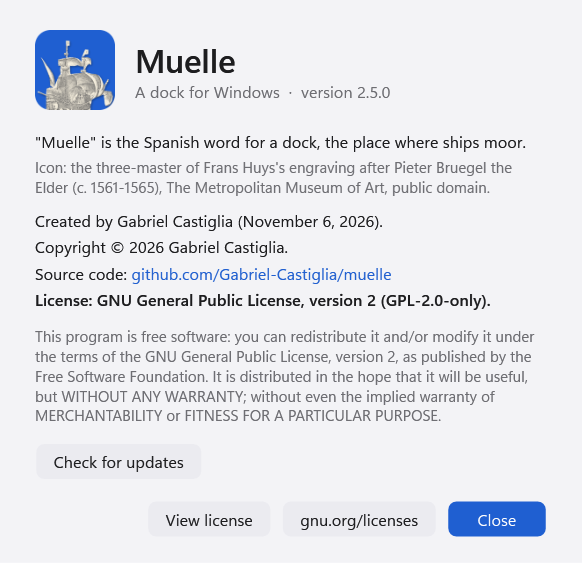

<p align="center"></p>

<h1 align="center">Muelle</h1>
<p align="center"><b>A dock for Windows, floating like the Mac's or fixed like Ubuntu's.</b></p>

<p align="center"></p>

Gabriel Castiglia · 27 November 2026 · version 2.6.0 · GPL-2.0-only

English · [Español](README.es.md) · [日本語](README.ja.md)

PDF manual: [`docs/Muelle-manual-en.pdf`](docs/Muelle-manual-en.pdf)

> **Windows 10/11 on x64 (64-bit Intel or AMD) only.** There is no build for ARM processors.

Muelle is an application dock for Windows 10 and 11, written in C# with .NET 10 and WPF. It can be a
floating dock with magnification under the pointer, in the style of macOS, or a fixed panel from edge
to edge, in the style of Ubuntu. Its interface is available in English, Spanish and Japanese; it starts in the
language chosen during setup (English when it runs without installation) and can be changed at any
time. It can be light, dark or follow Windows, in one of twelve colours. Several shortcuts can share one icon
as a stack, each screen can have its own icons, and new versions install themselves. "Muelle" is the Spanish
word for a dock, the place where ships moor.

## Requirements

- Windows 11, or Windows 10 version 1803 or later, on an x64 processor (64-bit Intel or AMD).

Nothing else has to be installed. Muelle carries its own .NET runtime, and the setup window runs on
the .NET Framework that Windows already includes.

## Installation

Download the files from the [latest release](https://github.com/Gabriel-Castiglia/muelle/releases/latest). There
are three ways to get Muelle, all built by `scripts\build.ps1` into the `dist` folder:

| File | What it is |
|---|---|
| `muelle-setup.exe` | Setup program, in English, Spanish or Japanese. The usual way to install. |
| `muelle.msi` | The same installation as a Windows Installer package, for silent installs: `msiexec /i muelle.msi /qn`. |
| `Muelle.exe` | The program on its own; it runs without installation from any folder. |

Each release also carries this manual in PDF, in English, Spanish and Japanese (`Muelle-manual-en.pdf`,
`Muelle-manual-es.pdf`, `Muelle-manual-ja.pdf`). The `SHA256SUMS.txt` file of each release lets you check a download first, in PowerShell:
`Get-FileHash muelle-setup.exe`.

The setup program opens a window with a language menu in its top right corner (English first, then
Spanish and Japanese), and every page changes language at once. It installs Muelle for all users in `C:\Program Files\Muelle`, which takes
administrator rights (Windows asks for them when installation starts), and adds Muelle to the Start
menu. The language chosen in the setup window is the one the dock uses when it starts for the first
time.



Running a newer `muelle-setup.exe` updates an installed Muelle and keeps each user's settings. If
Muelle is running, setup closes it before replacing its files and opens it again when done. An older
version cannot be installed over a newer one. An installed Muelle can also update itself: see [New versions](#new-versions).

For an installation without windows: `muelle-setup.exe /quiet` (Windows still asks for administrator rights).

To start Muelle with Windows, turn on Settings → Behaviour → "Start Muelle when Windows starts". If you made a
Task Scheduler task that starts Muelle (`\Muelle (inicio de sesion)` or `\Muelle`), the check box follows that task:
on enables it, off disables it, and the Run key of the registry is not used too, so Muelle never starts twice. The
change is made in the background, so the settings window never freezes while Windows applies it.

## Uninstallation

Open Windows Settings → Apps → Installed apps, find Muelle and choose Uninstall. The same setup
window opens, with its language menu, in the language chosen when Muelle was installed. It closes
Muelle if it is running, removes the program and the Start menu shortcut, and deletes the "Start with
Windows" entry of the user who uninstalls.

Each user's settings, in `%APPDATA%\Muelle`, are kept, so a later installation finds them. To remove
them as well, delete that folder.

For an uninstall without windows: `muelle-setup.exe /uninstall /quiet`.



## Using the dock

- A click on an icon opens the application or, if it is already open, brings its window to the
  front; with several windows, each click brings the next one. A click on the only window that is
  already in front minimises it. Shift+click or a middle click opens a new window.
- The icon bounces while an application starts, and a dot under an icon marks an open application.
- An icon follows its app: when the app is updated (Store apps too), changes the colour of its own icon (as
  Vigía does with its theme colour), or its shortcut or chosen icon file changes, the dock shows the new one
  within 15 seconds, without restarting. For a program, the dock
  takes the icon that the program's own shortcuts name when that file lives in the program's folder; an icon
  chosen by hand for one shortcut, from anywhere else, is left alone.
- Open applications that are not in the dock appear at its end and leave when they close. "Pin to
  dock" in their menu, or dragging them among the others, keeps them.
- Applications are added by dropping a shortcut or an `.exe` on the dock, with "Add application…" in
  the dock menu, or from Settings. Store apps (Teams, Terminal…) and shell objects such as Control
  Panel can be added too.
- Icons are reordered by dragging them along the dock and removed by dragging them out of it. "Lock
  dock" prevents both, and pinning, unpinning and renaming from the menu, to avoid accidental changes. In
  Settings → Dock applications, the buttons that would change the icons (Add…, New stack…, Edit stack…, Remove, Move
  up and Move down) are dimmed as well, and their tooltip says why; they come back as soon as the lock is turned off,
  from the dock menu or from Settings, even with the window open.
- A stack is one icon that holds several shortcuts: a click unfolds them beside it. See [Stacks](#stacks).
- An empty dock shows a "+" slot ("Drag your apps here"): drop apps on it, or click it to choose them.
- When the icons do not fit on a screen, they shrink on that screen only.
- With a full-screen application in front (a video, a game) the dock hides completely, also from the pointer at
  the screen edge, and comes back when the application leaves full screen.

| Action | Result |
|---|---|
| Click | Opens the app, brings its window to the front, or shows its next window; minimises the only window in front. |
| Shift+click, or middle click | Opens a new window of the app. |
| Right click | The menu of the icon, or of the dock on an empty part of it. |
| Drag along the dock / out of it | Reorders the icon / removes it (not with "Lock dock"). |
| Drop a shortcut or an `.exe` | Adds it at that place. |

Right-clicking an icon opens its menu, headed by the name of the app:

- A pinned app: Open another window (or Open, when the app is closed), Rename…, Unpin from dock, and More (Run
  as administrator, Open file location and, when the dock has stacks, Move to stack).
- An open app that is not pinned: Open another window, Pin to dock, and More (Run as administrator, Open file
  location).
- A stack: Open the stack, Edit stack… and Unpin from dock.

Then come Lock dock (with a check mark while it is on), Settings… and Quit Muelle. End task comes last and apart,
only while the app is running; it closes the app at once, without asking, so unsaved work in it is lost.
Right-clicking an empty part of the dock offers Add application…, New stack…, Lock dock, Settings… and Quit
Muelle. With "Lock dock" on, the lines that would change the icons are dimmed, and their tooltip says why: "The dock
is locked. To change the icons, turn off “Lock dock”." Everything else (style, language,
appearance, updates, About) is in Settings.



Rename… asks for the name shown under the pointer; an empty name goes back to the program's own name.

## Stacks

A stack keeps several shortcuts under one icon, like the stacks of the Mac dock. A click on it unfolds its
shortcuts beside the icon, each with its own icon; a click on one opens it, or brings its window to the
front if it is already open. "Edit stack…" at the end of the list opens the stack editor. A stack without
shortcuts says "The stack is empty".



- "New stack…" in the dock menu, or in Settings → Dock applications, creates one.
- In the editor: the name of the stack; its icon, either one of its own ("Choose icon…": an `.ico`, a
  program or a picture) or "Automatic icon", its first four shortcuts in a grid; and its shortcuts, with
  Add…, Remove, Move up and Move down. Nothing changes in the dock until "Save". If the stack left the dock
  while it was being edited (it was removed, or "Each screen has its own icons" was switched), "Save" says so
  and changes nothing.
- Only one editor is open at a time. Choosing "Edit stack…" for the stack that is already being edited brings its
  editor to the front. If the open editor has changes that were not saved, editing another stack first asks
  whether to discard them; nothing is dropped without asking.



- "Move to stack" in the menu of an icon puts that icon at the end of a stack.
- A stack is moved and removed like any other icon. An open app that is in a stack does not appear again
  at the end of the dock.

## Each screen with its own icons

With the dock on every screen, by default each copy shows the same icons. Settings → Location → "Each
screen has its own icons" gives every screen its own list. A screen seen for the first time starts with a
copy of the common icons, and from then on its icons are added, removed and reordered on its own dock, or
in Settings → Dock applications, which then has an "Icons of" list to choose the screen.

Muelle recognises a screen by the name Windows gives the physical monitor and the connector it is plugged
into, so it keeps its icons after a restart or when the screens are reordered; if Windows gives no such
name, by its display name and resolution. When a screen is disconnected its icons are kept in the settings
and come back when it is connected again. Turning the option off goes back to the common icons, and the
icons of each screen are kept for the next time.

## Settings

Right-click the dock → Settings…. Every change applies at once. `Muelle.exe --settings` starts Muelle with
the settings window open (useful for a shortcut).



| Group | Options |
|---|---|
| Style | Floating dock (Mac style), centred icons that grow under the pointer, or fixed panel (Ubuntu style), an edge-to-edge bar with the icons at its start; panel opacity (0 to 100 %, fixed panel only). |
| Location | Screen edge (bottom, top, left or right); show the dock on the primary screen only, on every screen (one copy on each) or on a specific screen; each screen has its own icons. |
| Behaviour | Reserve its screen strip (maximised windows do not cover it; not while the dock hides automatically); hide automatically (it shows up when the pointer reaches the edge); also show open apps that are not pinned; lock the dock; start Muelle when Windows starts; look for new versions once a day. |
| Appearance | As Windows, light or dark; one of twelve colours (also with the keyboard: Tab reaches the colours, the arrow keys move between them and Space chooses one). |
| Icons | Size (24 to 96 px); magnification under the pointer, from none up to twice the size; background of the floating dock, subtle glass or transparent (magnification and background apply to the floating dock only). |
| Language / Idioma / 言語 | Interface language: English, Español or 日本語. |
| Dock applications | The list of pinned applications and stacks, with Add…, New stack…, Edit stack… (or a double click), Remove, Move up and Move down; with its own icons per screen, "Icons of:" chooses the screen whose icons are listed. With "Lock dock" on, every button is dimmed and a double click does not open the stack editor. |

At the bottom of the window, "Open settings folder" shows `config.json` in File Explorer, "About…" opens About
Muelle, and "Close" closes the window (so does Esc). Options that do not apply to the chosen style are dimmed.



## Appearance

Muelle can be light, dark or follow the setting of Windows for apps (Settings → Personalisation →
Colours), and changes at once when Windows changes. The dock turns into frosted light glass or dark glass,
and the settings, About and update windows follow, title bar included. The appearance is chosen in
Settings → Appearance.


There are twelve colours: Blue (the default), Gold, Purple, Sky blue, Orange, Red, Yellow, Green, Teal, Pink,
Black and White. The one chosen colours the dot under open apps, the switches, sliders and
selected items, and the icon of Muelle's windows: the ship sails on a tile of that colour. The icon of
the Start menu stays blue, because Muelle is installed for all users and that shortcut belongs to all of
them.

A settings file from an earlier version keeps the dark dock it had; a new installation follows Windows.

## Keyboard and screen readers

The settings, stack editor, About and update windows can be used with the keyboard alone: Tab and Shift+Tab move
between the controls, and the control that has the keyboard focus shows it with a border in the accent colour or
a ring in the colour of the text. In Settings → Appearance, Tab reaches the twelve colours as one group, the arrow
keys move between them and Space chooses one; the colour with the focus has a frame of its own.

The dock never takes the keyboard focus, so typing always goes to the app in front. Screen readers such as
Narrator or NVDA see it through UI Automation as a tool bar named Muelle with one button per icon: each button has
the name of its app or stack, says whether the app is open or how many shortcuts the stack holds, and its default
action is the same as a click (it opens the app, brings its window to the front or opens the stack).

## New versions

Once a day, Muelle asks GitHub for its latest release; "Check for updates", in About Muelle… (Settings →
About…), asks at any time. If there is a newer version, a small window asks one question: Update now, What
is new (the release page) or Later.



After "Update now" everything happens by itself:

1. The `SHA256SUMS.txt` of the release must carry the author's signature (`release.sig`, checked against two
   keys built into Muelle); a release without a valid one is refused and can only be downloaded by hand from its
   page. Then the setup, `muelle-setup.exe`, is downloaded to `%TEMP%\MuelleUpdate` and checked against that
   `SHA256SUMS.txt`. A file that does not match is deleted and never run. From that check until the setup has
   started, Muelle keeps the file open for reading only, so nothing can change, replace or delete it in between.
2. Muelle notes how it was started and closes.
3. The setup installs in silence, with the language chosen when Muelle was installed; Windows asks for
   administrator rights, as for any installation. It waits for Muelle to be gone, and closes any other copy
   that runs from the install folder.
4. Muelle opens again, with the same arguments, and says that it was updated.

If anything fails, nothing is installed: Muelle keeps going, or opens again, and says what happened (for
example, when the administrator permission is refused). A copy of `Muelle.exe` that runs without
installation cannot replace itself; for it the window only offers the release page.

The requests carry nothing but the program name and its version. The daily check is turned off in Settings
→ Behaviour.

## Language

The interface is in English, Spanish and Japanese. The language is changed in Settings (Language /
Idioma / 言語, labelled in the three languages so it can be found from any of them), and it is
remembered. The setup window starts in English unless Muelle is already installed in another language. The names of the applications that Muelle adds on its first start (File Explorer, Notepad,
Calculator…) follow the interface language.

## Files

| What | Where |
|---|---|
| Installed program | `C:\Program Files\Muelle`, with `LICENSE.txt`, `README.txt`, `README.es.txt` and `README.ja.txt` |
| Settings | `%APPDATA%\Muelle\config.json` (it can be deleted to start over); the version before the last save in `config.previous.json` |
| Settings that could not be read | An icon or setting this version cannot read is dropped alone, never the whole list: what was dropped goes to `config.dropped-<date>.json` and the whole file as it was to `config.partial-<date>.json` |
| Error log, if anything fails | `%APPDATA%\Muelle\muelle.log`, kept under 512 KB (the previous part in `muelle.old.log`) |
| Update being installed | `%TEMP%\MuelleUpdate` (the setup and how Muelle was started); deleted a minute after the update installed |

## Troubleshooting

| Problem | What to do |
|---|---|
| The dock is not visible | A full-screen app in front hides it; with "Hide automatically" it shows up when the pointer reaches the screen edge; check Settings → Location → "Show the dock on:". Starting Muelle again while it runs does nothing: there is only one dock. |
| An app does not open | Muelle says "Could not open" with the reason Windows gives. If the program was moved or uninstalled, remove its icon and add it again. |
| An icon still shows the old picture | The dock looks for new icons every 15 seconds; if it stays old, remove the icon and add it again. |
| The settings look wrong | Quit Muelle and delete `%APPDATA%\Muelle\config.json` to start over, or rename `config.previous.json` to `config.json` to go back one save ("Open settings folder" in Settings opens the folder). |
| An update failed | Muelle says so and stays at its version; the setup log is in `%TEMP%`. The setup can always be downloaded from the [release page](https://github.com/Gabriel-Castiglia/muelle/releases/latest) and run by hand. |
| Something else fails | The details are in `%APPDATA%\Muelle\muelle.log`. |

## Known limitations

- When Muelle reserves its strip of the screen, Windows rearranges the desktop icons that were
  underneath and may move them to another monitor. This is how Windows treats any application bar. If
  it is a problem, turn off "Reserve its screen strip"; maximised windows will then go under the dock.

## Building from source

With the [.NET 10 SDK](https://dotnet.microsoft.com/download) installed:

```
dotnet build src\Muelle\Muelle.csproj -c Release
powershell -ExecutionPolicy Bypass -File scripts\build.ps1
```

The first command builds the program. The second builds everything in `dist`: the stand-alone
`Muelle.exe`, `muelle.msi` and `muelle-setup.exe`, and prints their SHA-256 hashes without writing any hash file
(the sums and the signature of a release are published separately); the WiX Toolset 5 is restored
automatically as a NuGet package. A release must carry `muelle-setup.exe`, `SHA256SUMS.txt` and `release.sig` with these
names, since the updates look for them.

`Muelle.exe --self-test <log>` checks the settings file, the stacks, the icons per screen, the lock in Settings, what
screen readers see of the dock and of the colours, the icons that follow their app, the detection of full-screen apps and the update functions (version comparison, hashes, the signature,
the setup held open while it starts, the setup's command line), and writes one line per check to the log; its exit code is the number of failures. It works on a throwaway settings folder in `%TEMP%` that it
deletes at the end, shows no window and leaves a running Muelle alone. With `--online` it also downloads
the setup of the latest release and checks it against its `SHA256SUMS.txt` and signature, without running it. The version is set in one place, `src\Muelle\Muelle.csproj`, and the installers and the
About window read it from there.

`scripts\screenshots.ps1` renders the images in `docs\images` with example apps (from a desktop session:
over SSH the dock image comes out empty), and `scripts/manual.sh` (with pandoc and Google Chrome, on macOS
or in Git Bash on Windows) builds the PDF manuals and `README.txt`, `README.es.txt` and `README.ja.txt` from this file, `README.es.md` and `README.ja.md`. `scripts/make_icon.py`
draws the icon in its twelve colours from the engraving in `assets/` (Python 3 with numpy, opencv-python
and Pillow).

| Folder | Contents |
|---|---|
| `src/Muelle` | The program. |
| `installer/Msi` | The MSI package (WiX). |
| `installer/SetupUI` | The setup window, in English, Spanish and Japanese (.NET Framework 4.7.2, WPF). |
| `installer/Setup` | The setup program that carries the setup window and the MSI (WiX bundle). |
| `scripts` | Build, images, icon and manuals. |
| `assets` | The engraving the icon comes from. |
| `docs` | PDF manuals, images and the manual stylesheet. |

## Version history

See [`CHANGELOG.md`](CHANGELOG.md).

## Licence

Copyright (C) 2026 Gabriel Castiglia.

Muelle is free software: you can redistribute it and/or modify it under the terms of the GNU General
Public License, version 2 only (GPL-2.0-only), as published by the Free Software Foundation. It is
distributed WITHOUT ANY WARRANTY. See [`LICENSE`](LICENSE) for the full text.

The icon is the armed three-master of Frans Huys's engraving after Pieter Bruegel the Elder (The Sailing
Vessels, c. 1561-1565), The Metropolitan Museum of Art, public domain (CC0).
